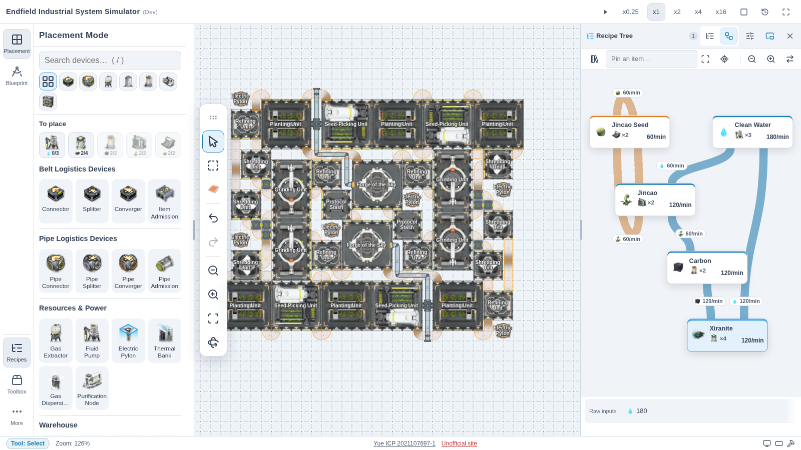
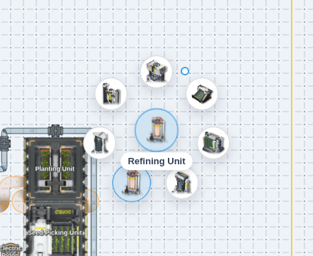
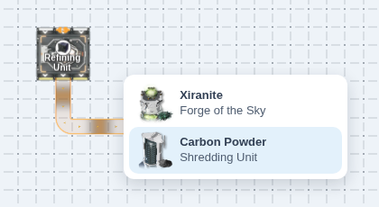
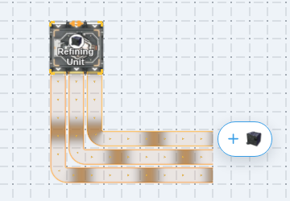
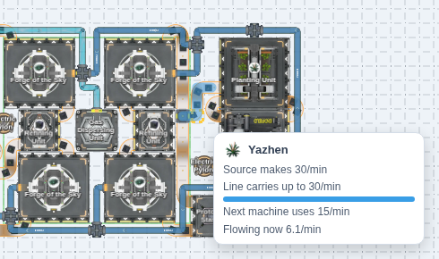

# Arknights: Endfield Industrial Planner · 明日方舟：终末地集成工业仿真器

A browser tool for laying out, simulating and saving integrated industry production lines in *Arknights: Endfield*. Lay out lines, connect belts and pipes, run the simulation, look up recipes, plan production chains and keep a blueprint library, all without opening the game.

一个运行在浏览器里的《明日方舟：终末地》集成工业产线布置、仿真与蓝图管理工具。不用打开游戏，就能在网页里摆产线、接传送带和管道、跑仿真、查配方、规划生产链路、保存蓝图。

This repository is a fork of [hsyhhssyy/IndustrialPlanner](https://github.com/hsyhhssyy/IndustrialPlanner). It reworks the planner for pen and touch first, with mouse and keyboard close behind: a tool rail on the canvas, a marking menu at the pen tip, belts drawn straight from ports, and a recipe tree that turns into a to-do list of devices to place.

本仓库是 [hsyhhssyy/IndustrialPlanner](https://github.com/hsyhhssyy/IndustrialPlanner) 的分支，按“手写笔与触控优先、鼠标键盘紧随其后”重新设计了交互：画布常驻工具条、笔尖环形菜单、从端口直接拉线，以及能变成待放置清单的配方树。



## Use it · 使用

The hosted sites run the upstream project, so they don't have this fork's pen and touch workflow yet. To get it, run the fork locally (see [Local development](#local-development--本地开发)).

下列在线站点部署的是上游项目，暂不包含本分支的笔与触控工作流。要使用本分支，请在本地运行（见[本地开发](#local-development--本地开发)）。

- International · 国际站: https://endfield.anonymous-test.top/
- Mainland China CDN · 中国大陆 CDN: https://endfield.amiyabot.com/

Desktop, tablets and landscape phones are supported; portrait phones show a rotate prompt. Supported browsers can install the app and keep using it offline once its resources are cached.

支持桌面、平板和横屏手机；手机竖屏会显示旋转提示。兼容的浏览器可以安装到桌面，离线资源缓存完成后断网也能使用。

## Pen and touch workflow · 笔与触控工作流

### Pick a device · 选设备



- **Marking menu.** Hold the pen on empty canvas (or anywhere while placing) to open a ring of device categories. Slide past a category to fan out its devices, and lift on one to have it in hand. The first device of each category sits straight on from the category, so frequent picks become two strokes you can do blind. Lift without moving and the ring stays open for tapping. A finger or mouse long-press on empty canvas opens it too.<br>**环形菜单。** 笔尖在空白画布上按住（放置中则任意位置），弹出设备分类环；划过某个分类展开其设备，在设备上抬笔即拿到手上。每个分类的第一台设备与分类在同一方向，常用设备可以盲划两笔取到。不移动直接抬笔，菜单会保持打开供点按。手指或鼠标在空白处长按也能打开。
- **Canvas hotbar.** Recently placed devices sit at the bottom corner of the tool rail, each with the recipe it was placed with. Tap one to swap the device in hand, drag it to drop one, hold it to see its name.<br>**设备快捷栏。** 最近放过的设备排在工具条底角，连同当时的配方。点按换手上的设备，拖出直接放一台，按住显示名称。
- **Palette.** Icon category chips filter the list without typing, and search also matches pinyin. When the canvas gets narrow the palette becomes a one-column icon shelf by itself, and it docks on the same side as the tool rail, so dragging the rail to your pen hand's edge brings the devices with it.<br>**设备面板。** 图标分类按钮无需输入即可筛选，搜索也支持拼音。画布变窄时面板自动收成一列图标设备架，并停靠在工具条同侧：把工具条拖到握笔手一侧，设备也跟过去。
- **Drag from any panel.** Palette tiles, Recipe Tree rows and flow-graph cards can be dragged onto the canvas; the recipe comes along when it is known. Drop a recipe card on a machine of the same type to change its recipe instead. Drag a raw input out of the plan and you get a Depot Unloader already linked to that item.<br>**从面板拖出。** 面板磁贴、配方树条目和流程图卡片都能直接拖到画布上，已知配方会一并带上；把带配方的卡片放在同型号设备上则改那台设备的配方。从规划里拖出原料，得到的是已链接该物品的仓库取货口。
- **Selecting a device.** A tap shows a small card above it with one row of actions (move, rotate, place another, switch mode, hold, delete) and, if no recipe is set yet, the recipe tiles. The full inspector opens from the card's corner button.<br>**选中设备。** 点按设备，上方出现一张小卡片：一行操作图标（移动、旋转、再放一台、切换模式、暂存、删除），还没设配方时直接列出配方磁贴。完整属性面板从卡片角上的按钮打开。

### Place · 放置

| Action · 操作 | Pen · 笔 | Finger · 手指 | Mouse · 鼠标 |
| --- | --- | --- | --- |
| Place · 放置 | Tap; the device stays in hand<br>点按；设备留在手上 | Tap a spot to move the preview, tap the preview to place<br>点按目标处移动预览，再点预览放下 | Click<br>单击 |
| Put the device down · 放下手上的设备 | Barrel tap on empty canvas<br>侧键点空白处 | Cancel button<br>取消按钮 | Right click / Esc<br>右键 / Esc |
| Place a row · 铺一排 | Drag with a device in hand<br>手持设备拖动 | Long-press the preview, then drag<br>长按预览后拖动 | Drag with a device in hand<br>手持设备拖动 |
| Rotate · 旋转 | Double-tap the device or preview<br>双击设备或预览 | Double-tap the device or preview<br>双击设备或预览 | Double-click / rotate key<br>双击 / 旋转快捷键 |
| Copy a placed device · 复制已放置设备 | Barrel tap it (barrel drag drags out a copy)<br>侧键点设备（侧键拖动拖出副本） | Place Another in the device actions<br>设备操作里的“再放一台” | Right click it<br>右键设备 |
| Delete · 删除 | Eraser end, or scratch back and forth across devices (start beside them)<br>笔的橡皮擦端，或从设备旁起笔来回涂抹划过设备 | Delete in the device actions<br>设备操作里的删除 | Delete key<br>Delete 键 |
| Undo / redo · 撤销 / 重做 | Rail buttons<br>工具条按钮 | Two-finger tap / three-finger tap<br>双指点按 / 三指点按 | Shortcuts or rail buttons<br>快捷键或工具条按钮 |

- Dragging a preview, a belt or a pipe to the edge of the canvas pans the map. The tool rail counts as an edge.<br>拖动预览或传送带、管道到画布边缘时地图会跟着平移，工具条也算边缘。

### Connect · 连线

- **Draw from a port.** With a pen, finger or mouse, drag from a device's port or the open end of a belt or pipe to draw a line. Release to commit. The rail's line tool does the same; it starts as belt, a second tap switches to pipe, and starting on a pipe outlet switches by itself.<br>**从端口拉线。** 用笔、手指或鼠标从设备端口或传送带、管道的开放末端拖出即可铺线，抬起提交。工具条上的铺线工具也一样：先铺传送带，再点一下换成管道，从管道出口起笔会自动换过去。
- **Auto-routing.** Draw toward a machine and, once the pen is on it, the line finds its own way into a free input around anything in the way, keeping close to where your stroke went. Existing lines are crossed with bridges. The mouse tools fall back to the same router when a single bend is blocked.<br>**自动寻路。** 朝一台设备画过去，笔一落到它上面，线就自己绕开障碍接进空闲的输入口，并尽量贴着笔画走过的位置；遇到已有的线用桥接器穿过。鼠标工具一次转弯走不通时也改用自动寻路。
- **Several lines in one stroke.** Start on an output, slide along the machine's edge across its neighbouring free outputs, then pull away: every output you swept gets its own line, running parallel and nesting at turns.<br>**一笔多线。** 从一个输出口起笔，先沿设备边划过相邻的空闲输出口，再拉离设备：划过的每个口各铺一条线，彼此平行，转弯时内外嵌套。
- **Add a machine at the line end.** When a line drawn from a device ends in open space, a **+** chip appears beyond its end. When one machine is the obvious consumer, one tap places it; otherwise open the chip to list the machines that consume what the line carries and pick one. It snaps onto the end with a matching input port, as one undo step. A line drawn into a machine with no recipe sets the recipe for it.<br>**在线末端接上设备。** 从设备拉出的线末端悬空时，末端外侧出现 **+** 提示。只有一种设备明显该接时点一下就放好；否则展开列出消费线上物品的设备再选。设备以匹配的输入口接在末端，一步即可撤销。把线接进还没设配方的设备，会按线上物品替它设好配方。

- **Chain the next machine.** Picking a machine at the **+** chip also lays one cell out of its product output and moves the chip there, so you can build a line machine by machine. With a plan pinned, the plan's machines come first with their *placed / needed* counts.<br>**接着往下铺。** 在 **+** 提示里选好设备后，它的产物输出口外会伸出一格线，提示随即移到那里，可以一台接一台地往下铺。钉了规划时，规划里的设备排在最前并显示“已放 / 需要”。

 

### Read a line · 线上读数



Hover a belt or pipe with the pen or mouse (or select one segment with a finger) to highlight the whole line and see what it carries: what the source machine makes, what the line can carry, what the next machine uses and, while the simulation runs, what is actually flowing. It warns when a line is over capacity or short of what the next machine needs.

笔或鼠标悬停在传送带、管道上（手指则点选一段线），整条线高亮并显示它运的物品：上游产出、线的运力、下游用量，仿真运行时还有实测流量；超出运力或不够下游使用时会提示。

### From plan to factory · 从规划到产线

- **Recipe Tree.** Pin target items and rates; the tree shows the whole chain with machine counts, by-products and raw inputs, as a tree or as a flow graph that fits narrow docks and short windows. Its settings take external supplies, sourcing policies for water, acid and sewage, and modules, and can turn the plan into a module.<br>**配方树。** 钉住目标物品与产量，按树或流程图显示整条生产链、设备数、副产物和原料，窄停靠栏与矮窗口也能看清。设置里可填外部供给、清水酸液污水的来源策略和模块，也能把规划转成模块。
- **To-do list.** The pinned plan appears at the top of the palette as device tiles with *placed / needed* counts. Tapping one hands you the device with its recipe already set. Machines with no recipe set count toward the plan for their type.<br>**待放置清单。** 钉住的规划以设备磁贴的形式显示在面板顶部，带“已放 / 需要”计数；点按即拿到已设好配方的设备。没设配方的同型号设备也计入。
- **Pour the plan into a loop.** With a plan pinned, draw a closed loop with the pen on empty canvas: every machine the plan still needs is laid out inside it with its recipe, one stage per column from raw inputs to the target, leaving room for belts. Machines that must go elsewhere (such as fluid pumps on the base edge) stay on the to-do list.<br>**把规划倒进圈里。** 钉了规划时，用笔在空白处画一个闭合的圈：规划里还缺的设备连同配方摆进圈里，从原料到产物每个阶段一列，列间留出铺线的空隙。必须放在别处的设备（例如贴着基地外缘的水泵）留在待放清单里。
- **Holding tray.** *Hold* lifts the selected devices off the canvas into a tray on the hotbar, together with their recipes, relative layout and the belts and pipes between them. Tap the entry to place the group again; it leaves the tray only once placed.<br>**暂存托盘。** “暂存”把选中的设备连同配方、相对布局和其间的传送带、管道一起收进快捷栏的托盘；点按条目即可重新放置，放下后才从托盘移除。
- **Depot bus.** With a pen or mouse, drag from a Depot Bus Port or Section to lay sections along the drag.<br>**存取线。** 用笔或鼠标从存取线源桩或存取线基段拖动，即沿拖动方向铺设基段。

### Pen settings · 手写笔设置

**Precise Pen Input** (on by default) treats the pen like a mouse on the canvas: hovering shows the preview, the tip clicks and drags, the barrel button is a right click, the eraser end deletes, and touches near an active pen are ignored. Turn it off to use the pen with touch gestures.

**手写笔精确输入**（默认开启）让笔在画布上像鼠标一样工作：悬停显示预览，笔尖点按和拖动，侧键相当于右键，橡皮擦端删除，活动笔附近的触摸会被忽略。关闭后笔按触控手势工作。

## What else it does · 其他功能

### Editing · 产线编辑

- Place, rotate, move and delete buildings; select by tap or box, add to or remove from a selection, move or delete in bulk.<br>放置、旋转、移动、删除建筑；点选、框选、增减选区、批量移动和删除。
- Draw belts and pipes with automatic joins; overlay belts to build splitters and convergers.<br>铺设传送带与管道并自动处理部分连接；叠放传送带生成分流、汇流结构。
- Overlap buildings temporarily while reworking a crowded line, then pull them apart.<br>改造拥挤产线时可临时重叠放置建筑，调整后再拆开。
- Switch between bases and plan for each base's size.<br>多基地切换，按不同基地规格规划布局。

### Simulation · 仿真与调试

- Run, pause and stop at up to 16× speed; inspect device status, shortages, blockages, buffers and output.<br>开始、暂停、退出仿真，最高 16 倍速；查看设备状态、缺料、堵塞、内部缓存和产出。
- Realistic or unlimited power, starting battery charge and adjustable consumption.<br>真实供电或无限供电，可设初始电量与耗电。
- Logistics order, port priorities, storage slots and preset items.<br>物流顺序、端口优先级、仓储格子与预置物品。
- Unlimited sources for testing, especially fluids: pumps and conduit outlets can supply without limit, and output ports can take items regardless of stock.<br>虚空来源便于调试，尤其是流体：抽水泵、暗管出口可无限供给，出货口可无视库存取出物品。
- The active base is simulated in full; treat cross-base flows as approximate.<br>当前活动基地完整计算，跨基地流程仅作近似参考。

### Blueprints · 蓝图

- Saved, local, public and temporary blueprints; copy a selection to a temporary blueprint, paste it and save it.<br>正式、本地、公共与临时蓝图；复制选区为临时蓝图、粘贴投放并保存。
- Import, export and share; preset items inside devices are kept.<br>导入、导出与分享，设备内预置物品随蓝图保存。
- Protocol cores travel with blueprints and ask for confirmation before placement; devices outside the buildable area are dropped when saving.<br>协议核心随蓝图处理并在放置前确认；保存时剔除建造区域外的设备。
- These are blueprints for this tool, not blueprints the game can import.<br>这里的蓝图是本工具内的布局数据，不能直接导入游戏。

### Planning and reference · 规划与查询

- Encyclopedia of items, buildings, recipes and production chains.<br>内置物品、建筑、配方与生产链路百科。
- Module balancer for built-in and custom modules across several stages, with the net difference per stage.<br>模块配平支持系统与自定义模块、多阶段配平和每阶段净差值。
- Undo history with a timeline, persistence across reloads, English and Chinese interface.<br>带时间线的撤销历史，刷新后保留状态，中英双语界面。

### Blueprint embedding · 蓝图嵌入

Other sites can embed a read-only blueprint canvas in an iframe by pointing a URL at a blueprint JSON file. Visitors can pan, zoom and run the simulation; the host page places its own controls and drives the canvas through a message API. See the [example on endfield.amiyabot.com](https://endfield.amiyabot.com/?embed=blueprint&blueprintUrl=%2Fblueprints%2Fgetting-started-tutorial.json&showBase=0&view=3d-top&animations=0&autoplay=0&warmupSeconds=0) and the [embedding guide](.github/readme-docs/blueprint-embed.md) (Chinese).

第三方网站可以用 iframe 嵌入只读蓝图画布，通过 URL 指定蓝图 JSON 文件，访客可以拖动、缩放和运行仿真；控件由接入方自行布局，并通过消息接口控制画布。参见 [endfield.amiyabot.com 上的示例](https://endfield.amiyabot.com/?embed=blueprint&blueprintUrl=%2Fblueprints%2Fgetting-started-tutorial.json&showBase=0&view=3d-top&animations=0&autoplay=0&warmupSeconds=0)和[蓝图嵌入接入指南](.github/readme-docs/blueprint-embed.md)。

## Local development · 本地开发

React 19, MobX, PixiJS, Vite, Vitest and TypeScript. · 基于 React 19、MobX、PixiJS、Vite、Vitest 和 TypeScript。

```bash
npm install
npm run dev             # dev server on port 5173 · 开发服务器（端口 5173）
npm run check           # lint, types, tests and build; run before calling work done · 检查、类型、测试与构建，提交前运行
npm test                # normal Vitest suite · 常规测试
npm run test:blueprint  # long real-factory simulations (opt-in) · 长时间真实产线仿真（按需）
npm run test:e2e        # Playwright (opt-in) · 端到端测试（按需）
```

| Directory · 目录 | Contents · 内容 |
| --- | --- |
| `src/app` | Shell, panels, dialogs, PWA, gesture router and input modules<br>应用外壳、面板、对话框、PWA、手势路由与输入模块 |
| `src/editor` | Editor state, placement validation, selection, history, logistics drafts<br>编辑器状态、放置校验、选区、历史、物流草稿 |
| `src/simulation` | Simulation host, worker protocol, topology compilation, runtime stages<br>仿真主机、Worker 协议、拓扑编译、运行阶段 |
| `src/renderer` | Pixi rendering, textures, decoration layers, blueprint previews<br>Pixi 渲染、贴图、装饰层、蓝图预览 |
| `src/audio` | Device sounds, loading and distance mixing<br>设备音效、加载与距离混音 |
| `src/registry` | Building, item and recipe definitions<br>建筑、物品、配方定义 |
| `src/sync` | Cloud sync providers (WebDAV, Cloudflare Worker, Yituliu)<br>云同步（WebDAV、Cloudflare Worker、一图流） |
| `src/domain` | Contracts between modules: state types, actions and queries<br>模块间契约：状态类型、动作与查询接口 |
| `src/shared` | Storage, themes, geometry, browser detection, i18n, shared utilities<br>存储、主题、几何、浏览器环境判断、国际化、公共工具 |

Contributor and agent conventions live in [AGENTS.md](AGENTS.md). · 协作约定见 [AGENTS.md](AGENTS.md)。

## Notes · 说明

- The tool is under active development; some features ship as beta first.<br>工具持续迭代中，部分功能会先以 Beta 形式上线。
- Recipes, buildings or icons from upcoming versions may be supported early from available information; the released game wins if they differ.<br>新版本的配方、建筑或图标可能依据现有资料提前支持，如与正式版不同，以游戏实装为准。
- For very complex priorities, extreme throughput or cross-base setups, confirm the result in the game.<br>非常复杂的物流优先级、极端吞吐或跨基地联动，请回到游戏内做最终确认。
- Browser data is local to the browser. Export important blueprints before clearing it or switching devices.<br>数据保存在当前浏览器中，清理浏览器数据或更换设备前请导出重要蓝图。

## Feedback · 反馈

Pen, touch and other workflow issues in this fork: open an issue on [this repository](https://github.com/Confusedphoton/IndustrialPlanner/issues). Devices, recipes, logistics or simulation results that differ from the game: report them [upstream](https://github.com/hsyhhssyy/IndustrialPlanner/issues).

本分支的笔、触控等交互问题请在[本仓库](https://github.com/Confusedphoton/IndustrialPlanner/issues)提交 Issue；设备、配方、物流或仿真结果与游戏不符，请反馈到[上游仓库](https://github.com/hsyhhssyy/IndustrialPlanner/issues)。

## License · 许可证

MIT License, see [LICENSE](LICENSE). · 本项目采用 MIT License，详见 [LICENSE](LICENSE)。
